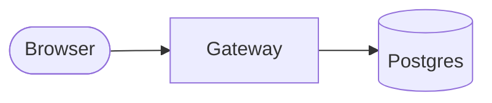

# pelago

Render all **33** Mermaid & Pele diagram types to deterministic, self-contained SVG in [Typst](https://typst.app), from the command line, or as a zero-dependency Rust library. `pelago` is a pure Rust port of [Pele](https://pele.run/) ([`obsidianmd/pele`](https://github.com/obsidianmd/pele) by [`@kepano`](https://github.com/kepano)), compiled directly to WebAssembly for Typst's plugin protocol.

- **Complete diagram coverage (33 types)** — `flowchart` / `graph`, `sequenceDiagram`, `classDiagram`, `stateDiagram` / `stateDiagram-v2`, `erDiagram`, `gantt`, `gitGraph`, `pie`, `mindmap`, `timeline`, `journey`, `quadrantChart`, `xychart-beta`, `sankey-beta`, `requirementDiagram`, `C4Context` (`c4`), `block-beta`, `packet-beta`, `kanban`, `architecture-beta`, `radar-beta`, `treemap-beta`, `venn-beta`, `ishikawa-beta`, `wardley-beta`, `treeView-beta`, `cynefin-beta`, `eventmodeling`, `usecase-beta`, `agentflow-beta`, `swimlane-beta`, `railroad-beta` (`ebnf` / `abnf` / `peg`), and `info`.
- **Zero runtime dependencies & no JS engine** — pure Rust parsers, Sugiyama / hierarchical / force / radial layout engines, text metrics, URL/CSS sanitizer, and SVG renderers compiled straight to `wasm32-unknown-unknown`.
- **Typst-native SVG output** — resolves Pele's CSS custom properties (`var(--...)`), `color-mix(in srgb, ...)`, generic font stacks, and `rx`/`ry` corner radii into plain SVG attributes compatible with `usvg`.
- **Pele parity (`--raw`)** — pass `raw: true` (or `--raw` on the CLI) to emit Pele's un-resolved CSS custom property stylesheet verbatim.
- **[Showcase Paper (`paper.pdf`)](paper.pdf)** — two-column Typst showcase document ([source: `paper.typ`](paper.typ)) rendering 9 live diagrams and theme comparisons.

## Installation (Typst `@local` Package)

`pelago.wasm` is prebuilt in the repository, so no Rust toolchain is needed to use the Typst package. Clone into your local Typst packages directory (or run `make install` from a checkout):

```sh
# Linux
mkdir -p "${XDG_DATA_HOME:-$HOME/.local/share}/typst/packages/local/pelago"
git clone https://github.com/lazy-mutex/pelago.git \
  "${XDG_DATA_HOME:-$HOME/.local/share}/typst/packages/local/pelago/0.1.0"

# macOS
mkdir -p "$HOME/Library/Application Support/typst/packages/local/pelago"
git clone https://github.com/lazy-mutex/pelago.git \
  "$HOME/Library/Application Support/typst/packages/local/pelago/0.1.0"
```

```powershell
# Windows (PowerShell)
New-Item -ItemType Directory -Force "$env:APPDATA\typst\packages\local\pelago"
git clone https://github.com/lazy-mutex/pelago.git "$env:APPDATA\typst\packages\local\pelago\0.1.0"
```

## Typst Usage

Import `mermaid` from `@local/pelago:0.1.0` (or directly from `"lib.typ"` inside a project directory):

```typst
#import "@local/pelago:0.1.0": mermaid

#mermaid("
flowchart TD
  A[Mermaid text] --> B{Flowchart?}
  B -- Yes --> C[pelago]
  B -- No --> D[Mermaid]
  C --> E([SVG])
  D --> E
")
```

### Fenced `mermaid` Code Blocks

Render every ```` ```mermaid ```` block automatically with a `show` rule:

```typst
#import "@local/pelago:0.1.0": mermaid
#show raw.where(lang: "mermaid"): mermaid


```

### Options & Theming

`mermaid` accepts standard `image` sizing options (`width`, `height`, `scaling`, `fit`, `alt`) alongside rendering options:

```typst
#mermaid(
  "flowchart LR\n  A[Source] ==> B{Valid?}\n  B -- Yes --> C([Publish])",
  width: 85%,
  theme: "dark", // or a dictionary: (bg: rgb("#f8fafc"), fg: rgb("#0f172a"), accent: rgb("#2563eb"), surface: rgb("#dbeafe"), border: rgb("#3b82f6"))
  config: (flowchart: (curve: "stepAfter", nodeSpacing: 36)),
  padding: 20pt,
  font-size: 11pt,
)
```

Additional helpers exported by `lib.typ`:
- `mermaid-svg(source, ..options)` — returns the rendered `<svg>...</svg>` string (`raw: true` preserves CSS variables).
- `mermaid-bytes(source, ..options)` — returns the rendered SVG as `bytes`.
- `supports(source)` — returns `true` when `pelago` can render the diagram type (all 33 Pele diagram types).
- `detect-type(source)` — returns the detected Mermaid diagram type string (e.g. `"flowchart"`, `"sequence"`, `"swimlane"`) or `none`.

## CLI Usage

```sh
cargo run --release -- diagram.mmd > diagram.svg
cat diagram.mmd | cargo run --release > diagram.svg

# Dark palette
cargo run --release -- --dark diagram.mmd > dark.svg

# Preserve Pele's CSS custom properties instead of resolving them
cargo run --release -- --raw diagram.mmd > pele.svg
```

## Rust Library Usage

```rust
use pelago::{render, RenderOptions};

let result = render("flowchart LR\n  A[Hello] --> B[World]", &RenderOptions::default())?;
println!("{} ({}x{})", result.diagram, result.width, result.height);
println!("{}", result.svg);
```

## Building `pelago.wasm` from Source

Requires the `wasm32-unknown-unknown` Rust target:

```sh
rustup target add wasm32-unknown-unknown
make wasm
# or directly:
cargo build --release --lib --target wasm32-unknown-unknown
cp target/wasm32-unknown-unknown/release/pelago.wasm pelago.wasm
```

Run the full test suite (unit tests, 300+ Pele parity & security corpus tests, CLI tests, and end-to-end `typst compile` tests):

```sh
cargo test
```

## Acknowledgements & License

`pelago` is a Rust port of **[Pele](https://pele.run/)** ([`obsidianmd/pele`](https://github.com/obsidianmd/pele)), created by [Steph Ango (`@kepano`)](https://github.com/kepano) and the Obsidian team. Credit for the diagram aesthetics, layout design, and CSS variable theming model goes to the original Pele project.

Bringing Pele natively to Typst as a pure Rust/WebAssembly plugin was inspired by the [`r/typst` community discussion *"Pele by Kepano on Typst?"*](https://www.reddit.com/r/typst/comments/1x8vhg1/pele_by_kepano_on_typst/). This port was built with AI-assisted *vibe coding*, guided by Pele's upstream architecture and validated against 300+ parity, edge-case, and security corpus tests alongside end-to-end `typst compile` integration tests.

Released under the [MIT License](LICENSE).
